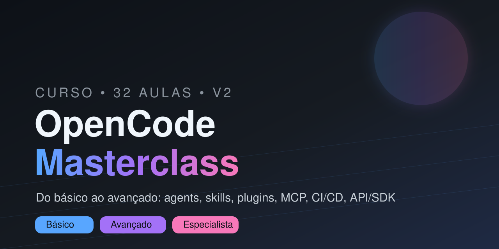

<div align="center" markdown="1">



# 🚀 OpenCode Masterclass — Curso do Básico ao Avançado

**O curso mais completo de [OpenCode](https://opencode.ai) (V2) em português.** 32 aulas práticas, 6 módulos + projetos finais, cobrindo *tudo*: agents, skills, commands, plugins, MCP servers, CI/CD, API, SDK e enterprise.

Do primeiro `opencode` até automação de pipelines com IA e integração de plataforma.

[](LICENSE)
[](https://opencode.ai/v2/docs/)
[](README.en.md)
[](README.md)
[](CONTRIBUTING.md)
[](https://github.com/murilogteixeira/opencode-masterclass/actions/workflows/ci.yml)
[](https://murilogteixeira.github.io/opencode-masterclass/)
[](https://github.com/murilogteixeira/opencode-masterclass/stargazers)

[**Começar agora**](#-roadmap-completo) · [🌐 Site](https://murilogteixeira.github.io/opencode-masterclass/) · [Cheat Sheet](CHEATSHEET.md) · [Glossário](docs/GLOSSARIO.md) · [Trilha](docs/TRILHA.md) · [Desafios](desafios/README.md) · [English](README.en.md)

</div>

---

## 🌎 About / Sobre

> **English:** A complete, hands-on **OpenCode course** (V2) in Portuguese — 32 lessons across 6 modules plus capstone projects. Learn the **AI coding agent** from install to advanced **agents, skills, commands, plugins, MCP servers, GitHub Actions CI/CD, the HTTP API, JavaScript client, SDK, and the enterprise Console**. Grounded in the official docs. → [Read the English overview](README.en.md).

O **OpenCode** é um agente de programação com IA, open source, que roda no terminal (TUI), desktop e web. Este repositório é um **curso/guia** progressivo e prático que ensina você a dominá-lo por completo — cada aula tem objetivo, conteúdo, **desafio prático** e links para a [documentação oficial](https://opencode.ai/v2/docs/).

**Tópicos cobertos:** `opencode` · `agents` · `skills` · `commands` · `plugins` · `MCP` · `permissions` · `policies` · `providers` · `models` · `websearch` · `references` · `compaction` · `CI/CD` · `GitHub Actions` · `HTTP API` · `JavaScript client` · `SDK` · `ACP` · `Console (enterprise)` · `migração V1→V2`.

---

## 📚 Sumário

- [Sobre](#-about--sobre)
- [Roadmap completo](#-roadmap-completo)
- [Começando](#-começando)
- [Estrutura do repositório](#-estrutura-do-repositório)
- [Recursos extras](#-recursos-extras)
- [Documentação oficial](#-documentação-oficial)
- [Como contribuir](#-como-contribuir)

---

## 🗺️ Roadmap completo

| Módulo | Título | Nível | Aulas | Foco |
|--------|--------|-------|:-----:|------|
| **01** | Fundamentos e Configuração | 🟢 Iniciante | 5 | Instalação, TUI, `opencode.json`/`cli.json`, modelos e providers |
| **02** | Personalização do Agente | 🔵 Intermediário | 7 | Instruções, comandos, permissões/policies, tools, skills, MCP, APIs |
| **03** | Estendendo o OpenCode | 🟠 Avançado | 5 | Agentes, plugins (uso + criação + RPC), websearch, referências/anexos |
| **04** | Automação e CI/CD | 🟠 Avançado | 3 | `opencode run`, sessões, GitHub Actions, workflows |
| **05** | Integração e Plataforma | 🟣 Especialista | 4 | HTTP API, cliente JS, SDK/Effect/Cloudflare, ACP/Web/remoto |
| **06** | Operação, Performance e Enterprise | 🟣 Especialista | 5 | Troubleshooting, compaction/snapshots/warming, custo, Console, migração |
| **Projetos** | Projetos Finais | 🟣 Especialista | 3 | Capstone, otimização, deploy |

👉 Detalhes e pré-requisitos em [`docs/TRILHA.md`](docs/TRILHA.md).

---

## 🚀 Começando

```bash
# 1. Clone o repositório
git clone https://github.com/murilogteixeira/opencode-masterclass.git
cd opencode-masterclass

# 2. Instale o OpenCode (V2)
curl -fsSL https://opencode.ai/v2/install | bash
# alternativas: npm i -g @opencode/cli | brew install anomalyco/tap/opencode-v2

# 3. Conecte um provedor e escolha um modelo
opencode        # abra a TUI e rode: /connect  e depois  /models
```

Depois, siga os módulos na ordem. Cada aula termina com um **desafio prático** — faça-o antes de avançar e versione seu progresso (um commit por aula).

### Pré-requisitos
- Terminal (Linux, macOS ou WSL2); Node.js só se usar a instalação via npm
- Conta em um provedor de modelos (ou Ollama/LM Studio local)
- Vontade de aprender fazendo 🙂

---

## 📁 Estrutura do repositório

```
opencode-masterclass/
├── README.md                 # Você está aqui (PT-BR)
├── README.en.md              # English overview
├── CHEATSHEET.md             # Referência rápida de comandos
├── CONTRIBUTING.md           # Como contribuir
├── AGENTS.md                 # Convenções do repo (dogfooding do OpenCode)
├── docs/
│   ├── TRILHA.md             # Trilha de estudo e pré-requisitos
│   └── GLOSSARIO.md          # Glossário de termos
├── desafios/                 # Exercícios e autoavaliação por módulo
├── assets/                   # Banner e imagens
├── mkdocs.yml                # Config do site (GitHub Pages)
├── scripts/                  # check-links.sh, check-structure.sh, build-docs.sh
├── .github/                  # CI, deploy de docs, release, dependabot, templates
├── .opencode/agents/         # Agente revisor do próprio repo (dogfooding)
├── examples/ci/              # Exemplo de workflow de revisão de PR
├── modulo-01-fundamentos/    # 5 aulas + exemplos
├── modulo-02-intermediario/  # 7 aulas + exemplos
├── modulo-03-avancado/       # 5 aulas + exemplos (agentes/plugins)
├── modulo-04-automacao/      # 3 aulas
├── modulo-05-integracao/     # 4 aulas + exemplos (client/SDK)
├── modulo-06-operacao/       # 5 aulas
└── projetos-praticos/        # 3 projetos finais
```

---

## 🧰 Recursos extras

- 📄 **[Cheat Sheet](CHEATSHEET.md)** — os comandos e trechos de config mais usados, em uma página
- 🧭 **[Trilha de estudo](docs/TRILHA.md)** — ordem sugerida e pré-requisitos
- 📖 **[Glossário](docs/GLOSSARIO.md)** — de *agent* a *worktree*
- ❓ **[FAQ](docs/FAQ.md)** — respostas rápidas sobre configuração, modelos, logs e segredos
- 🏋️ **[Desafios](desafios/README.md)** — exercícios e autoavaliação por módulo
- 🤖 **[Agente de exemplo](https://github.com/murilogteixeira/opencode-masterclass/blob/main/.opencode/agents/revisor.md)** — o próprio repo usa um agente revisor (dogfooding)
- 🔁 **[Workflow de PR](examples/ci/opencode-review.yml)** — copie e revise PRs com OpenCode no CI
- 🌐 **[Site](https://murilogteixeira.github.io/opencode-masterclass/)** — o curso publicado como site navegável

---

## 📚 Documentação oficial

Toda aula referencia a **fonte da verdade**: [opencode.ai/v2/docs](https://opencode.ai/v2/docs/).

- [Config](https://opencode.ai/v2/docs/config/) · [Agents](https://opencode.ai/v2/docs/agents/) · [Commands](https://opencode.ai/v2/docs/commands/) · [Skills](https://opencode.ai/v2/docs/skills/) · [Plugins](https://opencode.ai/v2/docs/plugins/)
- [Providers](https://opencode.ai/v2/docs/providers/) · [Models](https://opencode.ai/v2/docs/models/) · [MCP](https://opencode.ai/v2/docs/mcp-servers/) · [Permissions](https://opencode.ai/v2/docs/permissions/) · [Policies](https://opencode.ai/v2/docs/policies/)
- [API](https://opencode.ai/v2/docs/api/) · [Client](https://opencode.ai/v2/docs/build/client/) · [SDK](https://opencode.ai/v2/docs/build/sdk/) · [Console](https://opencode.ai/v2/docs/console/)
- [Troubleshooting](https://opencode.ai/v2/docs/troubleshooting/) · [Migrate V1→V2](https://opencode.ai/v2/docs/migrate-v1/)

---

## 🤝 Como contribuir

Contribuições são muito bem-vindas! Abra uma issue ou envie um PR — veja [`CONTRIBUTING.md`](CONTRIBUTING.md). Se este curso te ajudou, **deixe uma ⭐** para ajudar outras pessoas a encontrá-lo.

## 📄 Licença

[MIT](LICENSE) © 2026 Murilo Teixeira

---

<div align="center" markdown="1">

**Aprendeu algo? ⭐ Dê uma estrela · 🐛 [Reporte um problema](https://github.com/murilogteixeira/opencode-masterclass/issues) · 🍴 Faça um fork**

<sub>Feito com ☕ e OpenCode • Atualizado em 2026-10-16</sub>

</div>